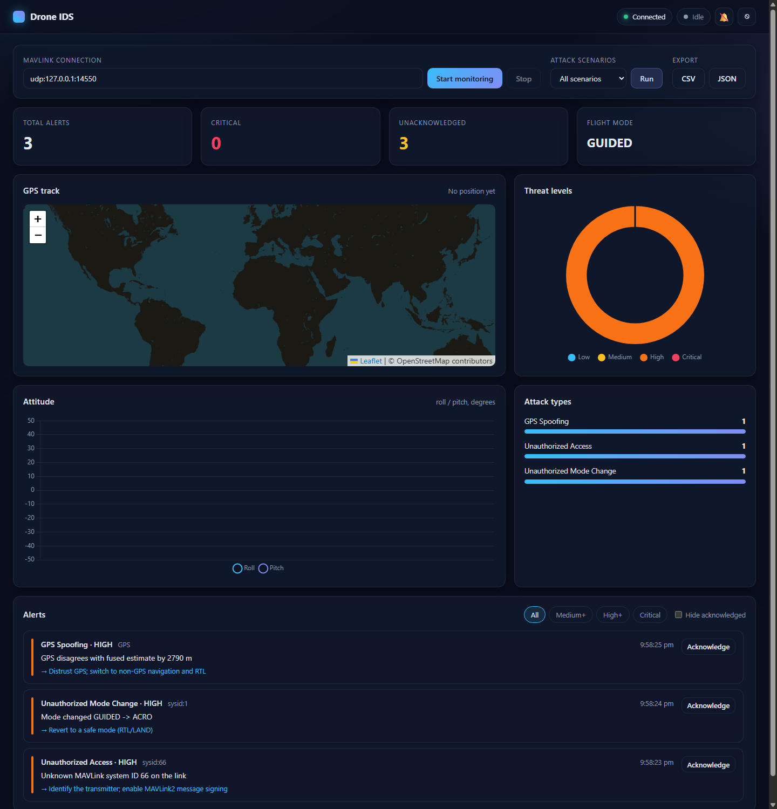

# 🚁 Drone Intrusion Detection System (IDS) Dashboard

<div align="center">


**A real-time web dashboard that detects cyber attacks on MAVLink-based drones.**

</div>



## Overview

A Final Year Project implementation of an intrusion detection system for UAVs. The IDS listens to a live
MAVLink stream (UDP, TCP or serial), runs every message through a set of detectors, stores alerts in SQLite,
and pushes them to a browser dashboard over WebSockets.

## Detections

| Detection | How it works | Level |
|---|---|---|
| **Unauthorized access** | MAVLink system ID (and sender IP, on `udpin`) not on the allow-list | HIGH |
| **Command injection** | State-changing messages (`COMMAND_LONG`, `SET_MODE`, `PARAM_SET`, `MISSION_*`, …) from a system that isn't an authorized ground station | CRITICAL |
| **Denial of service** | Command rate per source over a 1-second sliding window | CRITICAL |
| **GPS spoofing: jump** | Implied ground speed between GPS fixes exceeds `max_speed_mps` | HIGH |
| **GPS spoofing: divergence** | `GPS_RAW_INT` disagrees with the autopilot's fused `GLOBAL_POSITION_INT` estimate | HIGH |
| **GPS degradation** | Too few satellites or no 3D fix | MEDIUM |
| **Unauthorized mode change** | Vehicle `HEARTBEAT` transitions into a mode not on the allow-list | HIGH |
| **Flight anomaly** | Roll or pitch beyond `max_tilt_deg` | MEDIUM |
| **Link loss** | No vehicle heartbeat for `heartbeat_timeout_s` (jamming/link failure), one alert per outage | HIGH |

Repeated alerts of the same type from the same source are suppressed for `cooldown_s`.

## Project structure

```
drone_ids_dashboard/
├── backend/
│   ├── app.py              # Flask + Socket.IO server (REST API, auth, static frontend)
│   ├── simulator.py        # MAVLink drone simulator with injectable attacks
│   ├── config.yaml         # Detection thresholds and allow-lists
│   ├── ids/
│   │   ├── models.py       # Alert, ThreatLevel, AttackType
│   │   ├── config.py       # Defaults, YAML loading, validation
│   │   ├── detectors.py    # Network, GPS, behavioral and link detectors
│   │   ├── engine.py       # Routes MAVLink messages to detectors; cooldown; fan-out
│   │   ├── store.py        # SQLite alert persistence
│   │   ├── monitor.py      # Live MAVLink monitoring thread
│   │   ├── scenarios.py    # Built-in attack scenarios
│   │   └── mavlink_util.py # Helpers to build real MAVLink messages
│   ├── tests/              # pytest suite (unit, API, socket, live UDP end-to-end)
│   └── requirements.txt
├── frontend/
│   ├── index.html
│   ├── css/styles.css
│   ├── js/                 # api.js, charts.js, app.js
│   └── vendor/             # Pinned Socket.IO, Chart.js, Leaflet (works offline)
└── docs/
```

## Quick start

```bash
git clone https://github.com/jaibhortake/drone_ids_dashboard.git
cd drone_ids_dashboard/backend
python -m venv .venv && source .venv/bin/activate   # Windows: .venv\Scripts\activate
pip install -r requirements.txt
python app.py
```

The server prints a link containing a one-time access token, for example
`http://127.0.0.1:5000/#token=...`. Open it in a browser. To use a fixed token, set it first:

```bash
export IDS_TOKEN="choose-a-long-random-string"     # PowerShell: $env:IDS_TOKEN="..."
```

### Demo without a drone

In a second terminal, start the simulator, then click **Start monitoring** (default `udp:127.0.0.1:14550`):

```bash
cd backend
python simulator.py --attack all              # every attack, 3 s apart
python simulator.py --attack gps_jump --attack rogue_gcs
```

Simulator attacks: `gps_jump`, `gps_low`, `rogue_gcs`, `injection`, `flood`, `mode`, `attitude`, `jamming`.

You can also use **Attack scenarios → Run**, which feeds crafted MAVLink messages straight into the engine.

### Real drone / SITL

| Connection | Example |
|---|---|
| UDP (SITL, Mission Planner forward) | `udp:127.0.0.1:14550` |
| TCP | `tcp:192.168.1.100:5760` |
| Serial (Windows) | `COM3,57600` |
| Serial (Linux/macOS) | `/dev/ttyUSB0,57600` |

## Configuration

Thresholds and allow-lists live in [`backend/config.yaml`](backend/config.yaml). Unknown keys or wrong types are
rejected. They can also be changed at runtime with `POST /api/config`.

| Environment variable | Default | Purpose |
|---|---|---|
| `IDS_TOKEN` | random per run | Shared access token for the API and WebSocket |
| `IDS_HOST` / `IDS_PORT` | `127.0.0.1` / `5000` | Bind address. Use `0.0.0.0` only on a trusted network |
| `IDS_DEBUG` | off | `1` enables Flask debug mode. Never use it on a shared network |
| `IDS_SECRET_KEY` | random | Flask secret key |
| `IDS_CONFIG` | `backend/config.yaml` | Config file |
| `IDS_DB` | `backend/alerts.db` | SQLite database |
| `IDS_ALLOWED_ORIGINS` | same origin | Extra Socket.IO origins, comma-separated |

## Security

- Every API call and socket connection needs the token (`Authorization: Bearer <token>` / Socket.IO `auth`).
  The token is compared in constant time. The dashboard keeps it in `sessionStorage` only.
- By default the server binds to localhost with debug off, and the session secret is not stored in the code.
- WebSocket connections are same-origin only. CORS is not enabled.
- The dashboard renders server data with `textContent` only. A strict Content-Security-Policy blocks inline scripts.
- Inputs (scenario names, filters, config, connection strings) are validated on the server.

## API

All endpoints except `/` require `Authorization: Bearer <token>`.

| Method | Endpoint | Description |
|---|---|---|
| `GET` | `/api/status` | Alert counts, unacknowledged count, flight mode, monitoring state |
| `GET` / `POST` | `/api/config` | Read or update the configuration (validated) |
| `GET` | `/api/alerts?limit=50&min_level=HIGH` | Recent alerts |
| `POST` | `/api/alerts/<id>/ack` | Acknowledge an alert |
| `GET` | `/api/alerts/export?format=csv\|json` | Download all alerts |
| `GET` | `/api/scenarios` | List built-in scenarios |
| `POST` | `/api/test` `{"test_type": "all"}` | Run a scenario |

```bash
curl -X POST http://127.0.0.1:5000/api/test -H "Authorization: Bearer $IDS_TOKEN" \
     -H "Content-Type: application/json" -d '{"test_type": "all"}'
```

### WebSocket events

| Event | Direction | Payload |
|---|---|---|
| `start_monitoring` / `stop_monitoring` | client → server | `{connection_string}` |
| `new_alert` | server → client | alert |
| `status_update` | server → client | status |
| `monitor_state` | server → client | `{running}` |
| `vehicle` / `position` / `attitude` | server → client | live telemetry |
| `status` / `monitor_error` | server → client | `{message}` |

## Tests

```bash
cd backend
pip install -r requirements-dev.txt
pytest          # 54 tests: detectors, engine, SQLite, REST + Socket.IO, live UDP end-to-end
ruff check .
```

The end-to-end test starts the monitor on a real UDP port, runs the simulator against it, and checks that
each attack is detected.

## License

MIT
